# Casklet v0.1 — Consolidated System Design

Status: Approved v0.1 baseline; living document

Last updated: 2026-09-14

## 1. Purpose and diagram policy

This document is the visual entry point to Casklet's system design. Detailed reasoning and rules remain in the linked architecture, persistence, security, and engineering documents.

Only diagrams that answer a distinct engineering question are included:

- System context: who and what interacts with Casklet?
- Component diagram: where responsibilities and dependency boundaries live.
- Data-flow diagrams: how untrusted data and state-changing operations move.
- ER diagram: how durable entities relate.
- Sequence diagrams: how crash-sensitive workflows are ordered.
- Trust-boundary diagram: where security validation is required.
- Deployment diagram: what actually runs and is installed in v0.1.

## 2. System context

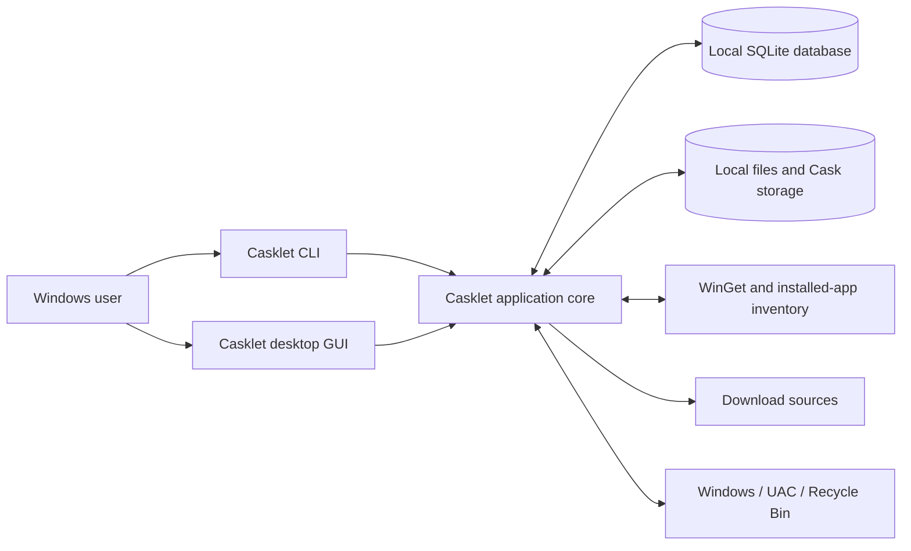

Casklet is local-first. There is no Casklet cloud backend, account server, or always-running daemon in v0.1.

## 3. Runtime component architecture

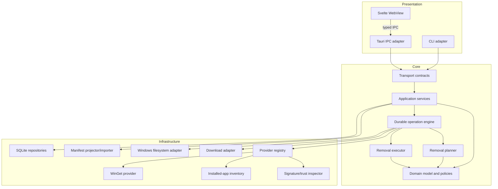

Dependency direction is inward: presentation and infrastructure depend on application/domain contracts; the domain does not depend on Tauri, SQLite, WinGet, or OS APIs.

## 4. DFD Level 0 — Cask lifecycle

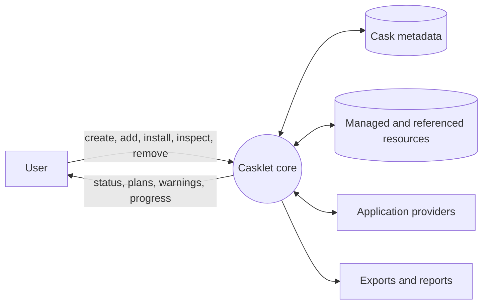

## 5. DFD Level 1 — Add file or folder

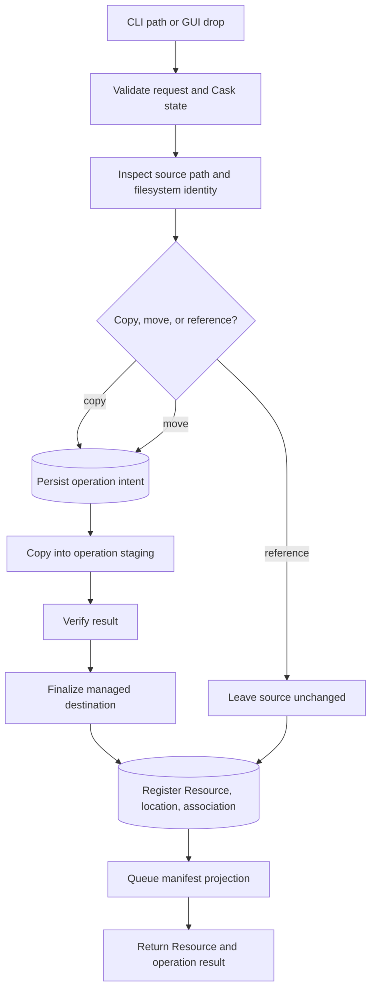

For cross-volume moves, the staged copy is verified and registered before source removal. Drag-and-drop never silently defaults to move.

## 6. DFD Level 1 — Application installation

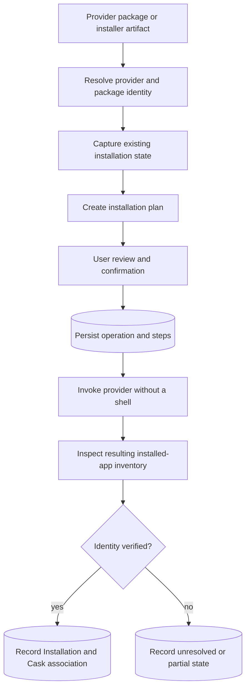

Installer exit success does not independently prove installation success or ownership.

## 7. DFD Level 1 — Cask destruction

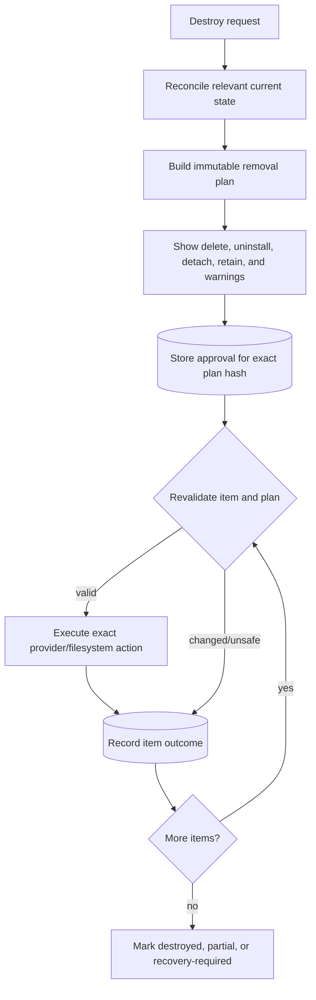

The GUI cannot submit executable deletion items. It approves an exact plan generated and stored by the core.

## 8. Entity relationship model

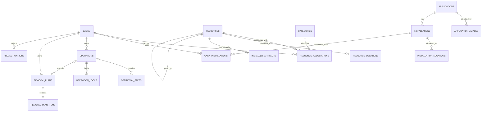

Key modeling rules:

- Paths are not Resource identities.
- Cask-to-Resource and Cask-to-Installation relationships are many-to-many.
- Category belongs to the Resource association.
- Installer artifact, logical Application, and installed instance are distinct.
- Sharing is derived from active associations.

## 9. Sequence — crash-safe managed copy

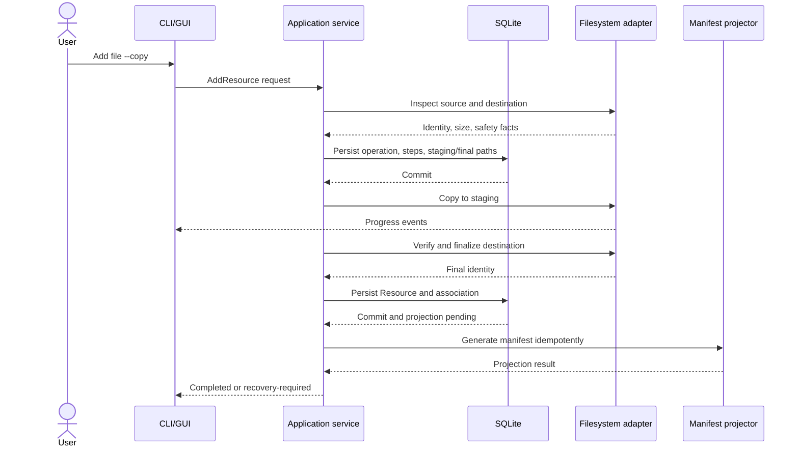

No database transaction remains open during the copy.

## 10. Sequence — plan-before-destruction

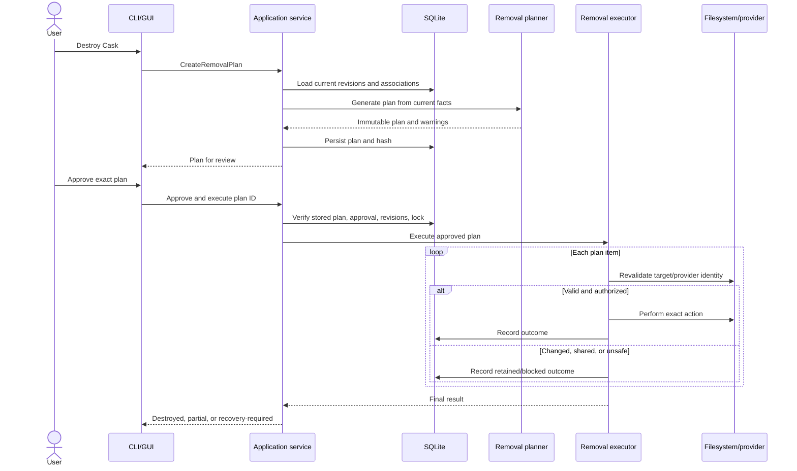

## 11. Trust boundaries

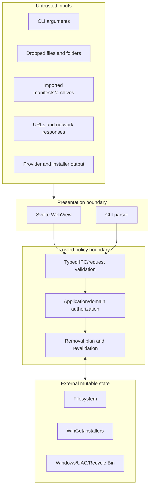

Every arrow crossing into the trusted policy boundary requires typed validation. Data returning from the filesystem or providers is also revalidated; external reality is not inherently trusted.

## 12. v0.1 deployment model

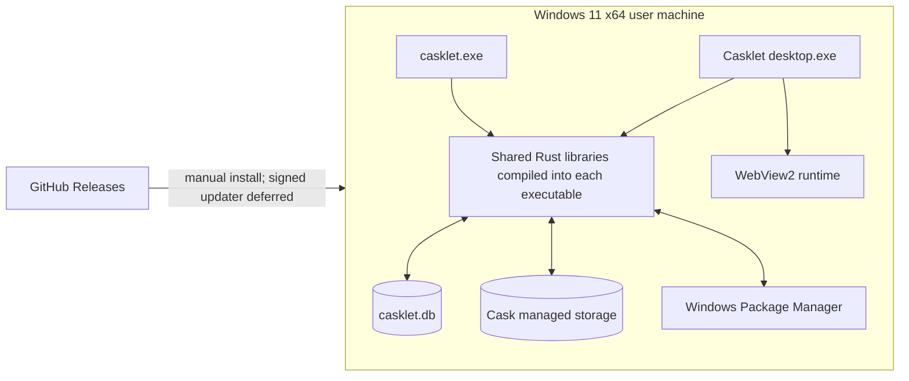

The shared core is a source/library boundary, not a separate network service. CLI and desktop are separate processes and coordinate through SQLite operations and persistent locks.

## 13. Document relationships

```text
Product requirements and cross-platform decisions
        -> domain model
        -> component architecture
        -> persistence design
        -> security threat model
        -> repository/tooling design
        -> this consolidated visual map
```

Detailed sources:

- `docs/architecture/component-architecture.md`
- `docs/architecture/persistence-design.md`
- `docs/security/threat-model-v0.1.md`
- `docs/engineering/repository-and-tooling.md`
- `domain model.txt` until normalized into the architecture directory

## 14. Deferred diagrams

The following diagrams would not add enough value yet and are deliberately deferred:

- Cloud deployment and synchronization topology.
- Public plugin architecture.
- Isolation/container/VM topology.
- Linux and macOS provider detail.
- UI screen navigation map and wireframes.
- Class diagrams mirroring every Rust type.

They should be added only when their corresponding features enter an approved scope.
