# Phase 8 — Casklet v0.1 Delivery and Implementation Roadmap

Status: Approved on 2026-09-15

Last updated: 2026-09-14

## 1. Purpose

This phase turns the approved product and architecture into an executable delivery plan. It defines the order of implementation, what each increment proves, its acceptance criteria, the accompanying learning goals, and the release gates for Casklet v0.1.

This is the final design gate before implementation. Approval authorizes Milestone 0 scaffolding; it does not authorize skipping the safety or quality gates in later milestones.

## 2. Delivery principles

1. Build vertical slices through domain, application, infrastructure, CLI, and GUI rather than completing layers in isolation.
2. Establish safety behavior before destructive features.
3. Use fake providers before invoking real installers or uninstallers.
4. Keep every milestone runnable and leave the main branch healthy.
5. Add only dependencies required by the current slice.
6. Treat schemas, migrations, commands, and public errors as versioned interfaces.
7. Prefer a smaller truthful feature over broad automation that cannot make reliable guarantees.
8. Keep CLI and GUI behavior equivalent while allowing presentation appropriate to each interface.
9. Measure completion with acceptance evidence, not the presence of classes or screens.
10. Perform manual exploratory testing in addition to automation for filesystem and installer behavior.

## 3. What must, may, and must not ship

### Required for v0.1 stable

- Create, rename, list, inspect, and archive/destroy Casks.
- Add files and directories by managed copy, managed move, or external reference.
- GUI drag-and-drop with an explicit copy, move, or reference decision.
- Equivalent non-interactive CLI commands.
- Built-in categories, custom categories, and per-association categorization.
- Logical, physical, and reclaimable storage reporting with uncertainty shown.
- Durable operations, progress, cancellation where safe, recovery, and reconciliation.
- Inspectable removal plans and revalidation before every destructive step.
- Individual, category, and whole-Cask cleanup with conservative defaults.
- Portable application registration and lifecycle support.
- WinGet discovery, installation, association, inspection, and eligible uninstall.
- Existing-installed-application association without inferred ownership.
- Installer artifact registration and cautious MSI/EXE correlation without arbitrary tracing claims.
- Versioned JSON inventory export, recovery manifests, and a human-readable report.
- Local structured diagnostics, accessible GUI workflows, CLI JSON output, documentation, checksums, and an SBOM.

### Nice to have if core gates are already green

- Richer storage visualizations.
- Convenient recent-Cask lists and saved UI preferences.
- Additional deterministic file classifiers.
- More portable archive formats after ZIP.
- Additional WinGet metadata presentation.
- Improved report theming.

Nice-to-have work cannot delay correctness, recovery, accessibility, or release hardening.

### Deferred beyond v0.1

- Linux and macOS releases.
- Isolation, sandboxing, snapshots, and rollback.
- Cloud accounts, sync, collaboration, remote APIs, or hosted infrastructure.
- Browser/download interception and whole-system tracing.
- Public plugins, game-launcher integrations, drivers, or service management.
- Background daemon, automatic updater, and enterprise MSI deployment.
- Automatic cleanup of arbitrary EXE installations.

## 4. Milestone map

```mermaid
flowchart LR
    M0[M0 Foundation] --> M1[M1 Walking skeleton]
    M1 --> M2[M2 Resource intake]
    M2 --> M3[M3 Operations and recovery]
    M3 --> M4[M4 Safe cleanup]
    M4 --> M5[M5 Export and portability]
    M5 --> M6[M6 Portable applications]
    M6 --> M7[M7 Installed-app inventory]
    M7 --> M8[M8 WinGet lifecycle]
    M8 --> M9[M9 Installer artifacts]
    M9 --> M10[M10 Product hardening]
    M10 --> A[Public alpha]
    A --> B[Beta]
    B --> S[v0.1 stable]
```



Milestones are dependency-ordered, not calendar estimates. After the project has real velocity data, issues can be sized without inventing unreliable dates now.

## 5. Milestone 0 — Reproducible foundation

### User-visible outcome

No product capability yet. A new contributor—or a future Codex task—can clone, validate, build, test, and understand the repository through documented commands.

### Implement

- Scaffold the approved Cargo and pnpm workspaces and crate boundaries.
- Pin Rust, Node, pnpm, Tauri, Svelte, and TypeScript versions.
- Commit lockfiles and baseline configuration.
- Add `xtask` commands for check, test, contract generation, and package verification.
- Add formatting, linting, license/advisory checks, secret scanning, and initial CI.
- Create approved ADRs for architecture, persistence, contracts, GUI stack, and platform strategy.
- Normalize `domain model.txt` into `docs/architecture/domain-model.md` and preserve its design meaning.
- Add contributor, security, and local bootstrap documentation.
- Establish separate development and test application-data locations.

### Acceptance gate

- A clean machine can follow the documented bootstrap procedure.
- One command runs the local quality gate.
- CI reproduces the same checks on Windows.
- Dependency direction is enforced by workspace structure and reviewable manifests.
- Placeholder binaries open and exit cleanly, but contain no invented business behavior.
- No production secret or paid service is required.

### Learning checkpoint

Understand Cargo workspaces/crates, Rust ownership at a basic level, pnpm workspaces, Tauri's Rust/WebView split, and why dependency direction matters.

## 6. Milestone 1 — Cask walking skeleton

### User-visible outcome

A user can create, list, and inspect an empty Cask from both the CLI and desktop GUI. The Cask persists across restarts.

### Implement

- Cask identity, name, timestamps, lifecycle state, and domain invariants.
- Versioned command/query DTOs and generated TypeScript contracts.
- Application services and repository ports.
- SQLite startup, migrations, repositories, and development/test database paths.
- CLI composition root and commands.
- Minimal Tauri composition root and Svelte shell.
- Typed error mapping and correlation IDs.
- Empty per-Cask managed storage and manifest projection.

### Acceptance gate

- Duplicate/invalid names follow an explicit tested policy.
- CLI and GUI observe the same persisted state.
- Restarting either client preserves data.
- Contract regeneration produces a clean tree.
- Domain tests, migration tests, CLI tests, and a GUI smoke test pass.
- Neither UI contains direct SQL or filesystem business logic.

### Learning checkpoint

Trace one request from Svelte or `clap`, through a typed application command, into a repository port and SQLite adapter, then back as a view DTO.

## 7. Milestone 2 — Resource intake and inspection

### User-visible outcome

A user can add a file or directory by copy, move, or reference; categorize it; and inspect location, management state, availability, and storage information.

### Implement

- Resource, location, association, provenance, availability, and category rules.
- Safe managed-storage path allocation and staging.
- Crash-aware copy and move workflows without yet exposing deletion.
- Reference workflow that never implies ownership.
- Bounded directory scanning, file identity, classification evidence, and storage accounting.
- CLI `add` workflow with explicit mode and machine-readable output.
- GUI file/folder picker and drag-and-drop review screen.
- Built-in and custom categories.

### Acceptance gate

- Copy, move, and reference are visibly distinct in CLI and GUI.
- Dragging an item never performs a destructive move without explicit selection and confirmation.
- References remain outside managed storage and are never presented as Cask-owned.
- Symlinks, junctions, inaccessible paths, collisions, disk-full cases, and interrupted copies have tests.
- Large directories report bounded progress and do not freeze the GUI.
- Logical, physical, and reclaimable size are not conflated.

### Learning checkpoint

Understand Windows path/identity hazards, Rust error propagation, bounded blocking work, Svelte drag-and-drop events, and why association metadata belongs separately from a resource.

## 8. Milestone 3 — Durable operations and recovery

### User-visible outcome

Long-running work has durable status and progress. After a crash or forced exit, Casklet explains unfinished work and offers safe recovery actions.

### Implement

- Operation and operation-step state machines.
- Persistent locks, cancellation semantics, progress events, and polling fallback.
- Startup detection of abandoned operations.
- Reconciliation of staged files, final files, database state, and manifests.
- Projection job retry and manifest regeneration.
- Recovery-required views in CLI and GUI.
- Structured redacted logs and diagnostics bundle generation.

### Acceptance gate

- Fault-injection tests interrupt work at every persistence/filesystem boundary.
- Restart never silently marks uncertain work successful.
- Recovery is idempotent and defaults to preserving ambiguous data.
- Concurrent CLI/GUI operations respect persistent locks.
- Logs identify an operation without leaking secrets or unnecessary private paths.

### Learning checkpoint

Understand why external work cannot be one database transaction, how journals enable recovery, and the difference between durable operation state and transient progress events.

## 9. Milestone 4 — Removal planning and safe cleanup

### User-visible outcome

A user can preview and execute cleanup for selected resources, a category, or a whole Cask, with a precise explanation of what will be removed, preserved, or needs attention.

### Implement

- Immutable removal-plan and plan-item models.
- Eligibility policy based on management, containment, provenance, sharing, identity, and current verification.
- Plan expiry, approval, revalidation, execution journal, partial failure, and retry.
- Recycle Bin adapter where supported and narrowly scoped permanent deletion only when explicitly chosen.
- CLI plan/show/approve/execute flow and explicit non-interactive flags.
- GUI review and confirmation workflow with accessible warnings.
- Cask lifecycle completion that retains history required for recovery/audit.

### Acceptance gate

- There is no deletion entry point that bypasses the planner/executor.
- Referenced, shared, missing, changed, broad, or unverified targets are preserved by default.
- Every target is resolved and revalidated immediately before action.
- Symlink/junction swaps and path replacement between planning and execution are tested.
- Partial failure yields an accurate resumable journal.
- Domain property tests prove the safety invariants over generated state combinations.
- An independent security-focused review of destructive paths is completed before enabling them in a public build.

### Learning checkpoint

Understand time-of-check/time-of-use risk, capability-based design, property testing, and why confirmation UI is not itself authorization.

## 10. Milestone 5 — Export, manifests, and portability

### User-visible outcome

A user can export a privacy-reviewed JSON inventory and human-readable report. Per-Cask manifests can help reconstruct metadata after database loss without granting deletion authority.

### Implement

- Versioned inventory export schema and checked-in JSON Schema.
- Portable versus machine-specific export profiles.
- Human-readable Markdown report.
- Atomic per-Cask recovery-manifest projection.
- Strict import parsing, compatibility checks, resource ceilings, and non-destructive preview.
- Database rebuild/reassociation workflow from manifests and current observations.

### Acceptance gate

- Export fixtures validate against the published schema.
- Default shared exports exclude sensitive local paths and machine identifiers.
- Unknown future fields/versions follow the documented compatibility policy.
- Imported or recovered metadata cannot independently authorize deletion.
- Corrupt/truncated manifests fail safely and leave current state intact.

### Learning checkpoint

Understand schema evolution, serialization boundaries, forward/backward compatibility, and why checksums prove integrity rather than trust.

## 11. Milestone 6 — Portable application lifecycle

### User-visible outcome

A user can add a supported portable ZIP application to a Cask, inspect it, launch it, and later remove it through the normal removal-plan workflow.

### Implement

- Application, installation, installation-location, and Cask-installation distinctions.
- Portable ZIP provider with validated extraction and executable selection.
- Archive traversal, link, expansion, file-count, and size protections.
- Typed launch operation without a generic shell.
- Version/provenance evidence and provider capabilities.
- CLI and GUI portable-installation workflows.

### Acceptance gate

- Malicious archive fixtures cannot escape staging or exceed configured limits unnoticed.
- Launch accepts a verified installed-instance ID, not a free-form command string.
- Portable installations use managed storage and are removable only through an approved plan.
- Association and installation ownership remain separate.

### Learning checkpoint

Understand provider capabilities, archive attacks, typed process invocation, and the difference among an application, an installed instance, and a Cask association.

## 12. Milestone 7 — Windows installed-application inventory

### User-visible outcome

A user can search detected Windows applications and associate an existing installation with a Cask. Casklet clearly says that it did not install or own that application.

### Implement

- Windows installed-application inventory adapter.
- Normalized application identity with retained raw evidence.
- Installation verification and refresh/reconciliation.
- Association/disassociation workflows.
- Ambiguous-match and missing-installation states.
- Read-only CLI and GUI discovery experiences.

### Acceptance gate

- Association never changes installation ownership or uninstall eligibility.
- Duplicate display names do not collapse distinct installed instances.
- Inventory parsers tolerate malformed/unexpected system records.
- Refresh can mark changed or missing state without destroying historical evidence.
- Ordinary CI uses recorded fixtures; dedicated manual tests use real Windows state.

### Learning checkpoint

Understand adapter boundaries, evidence normalization, Windows installation metadata, and why names and paths are not identities.

## 13. Milestone 8 — WinGet-managed lifecycle

### User-visible outcome

A user can search WinGet, review a package, install it for a Cask, observe progress, and uninstall it later only when Casklet can prove eligibility.

### Implement

- WinGet provider adapter and capability reporting.
- Typed argument construction, package identity pinning, timeouts, cancellation, and bounded output capture.
- Pre/post inventory snapshots and installed-instance correlation.
- Durable installation/uninstallation operations.
- Shared/global association warnings and conservative uninstall eligibility.
- GUI and CLI review flows for install and uninstall.

### Acceptance gate

- No user/provider string is executed as a shell command.
- Failed, cancelled, ambiguous, or timed-out installs do not become owned successful installations.
- Provider output is treated as untrusted and sanitized before display/logging.
- Uninstall requires verified provider identity, Casklet-created provenance, no blocking associations, and an approved revalidated plan.
- Provider integration tests use a fake executable; real WinGet mutation is manual or isolated and explicitly invoked.

### Learning checkpoint

Understand child-process control, provider contracts, correlation uncertainty, least privilege, and why successful process exit is only one item of installation evidence.

## 14. Milestone 9 — Installer artifacts and cautious correlation

### User-visible outcome

A user can register an MSI or EXE installer with a Cask, launch it through a guided workflow, and review any installed application Casklet can confidently correlate. Ambiguous results remain unowned and require user review.

### Implement

- Installer-artifact identity, hashing, metadata, signature evidence, and source recording.
- Safer MSI metadata/correlation path where reliable.
- Restricted EXE launch using typed process APIs.
- Pre/post installed-application inventory comparison.
- Candidate scoring/evidence display without presenting heuristics as fact.
- Explicit confirm-association workflow.

### Acceptance gate

- Casklet makes no arbitrary-installer cleanup guarantee.
- A signature is presented as signer evidence, not safety certification.
- Multiple, missing, or weak candidates never create automatic ownership.
- Elevation is visible, limited to the external installer, and never elevates the whole Casklet GUI.
- Child-process ambiguity and reboot-required outcomes become review/recovery states.

### Learning checkpoint

Understand Authenticode's limits, MSI versus arbitrary EXE behavior, heuristic confidence, elevation boundaries, and honest product-language design.

## 15. Milestone 10 — Product and release hardening

### User-visible outcome

Casklet behaves as a coherent Windows product rather than a set of features and is ready for controlled public testing.

### Implement

- Complete dashboard, Cask detail, resource review, operation center, recovery, and settings flows.
- Keyboard navigation, focus management, screen-reader labels, contrast, reduced-motion behavior, and actionable errors.
- Performance budgets and profiling for startup, large inventories, scanning, and storage aggregation.
- Data migration, backup, corruption, low-disk, long-path, non-ASCII, and multi-volume test passes.
- Packaging spike and final choice of supported per-user desktop installer.
- CLI ZIP, desktop installer, checksums, SPDX SBOM, release notes, license notices, and uninstall testing.
- User guide, safety explanation, troubleshooting guide, privacy statement, and known limitations.
- Full threat-model and architecture conformance review.

### Acceptance gate

- All required v0.1 workflows pass automated and documented manual tests on supported Windows 11 x64 environments.
- No open critical/high security issue or known data-loss defect remains.
- Migration from every previously published prerelease database fixture passes.
- Installation and removal of Casklet itself do not silently remove user Casks.
- Release artifacts are reproducible enough to trace source revision, dependency locks, checksums, and SBOM.
- UI accessibility checks and manual keyboard workflows pass.
- Recovery and destructive-operation documentation matches actual behavior.

### Learning checkpoint

Understand release engineering, accessibility, performance profiling, migration compatibility, supply-chain evidence, and the distinction between feature-complete and production-ready.

## 16. Release progression

### Internal development builds

Produced throughout the milestones. They are not promoted as safe for important data and may reset only development/test state according to explicit developer instructions.

### Public alpha

Begins only after Milestones 0–10 satisfy their gates. The alpha validates real-world hardware, filesystem layouts, WinGet behavior, installer variation, terminology, and usability. It should default to the most conservative cleanup behavior and prominently communicate limitations.

### Beta

Begins after alpha feedback is triaged, schema compatibility is exercised by actual upgrades, critical workflows are stable, crash/recovery evidence is satisfactory, and no unresolved data-loss-class issue remains.

### v0.1 stable

Requires:

- The approved v0.1 scope or an explicitly documented scope amendment.
- Security, migration, recovery, accessibility, packaging, and documentation gates.
- A supported-version policy and known-limitations document.
- Signed artifacts if practical for trust and operating-system reputation; lack of affordable code signing must be explicitly assessed before calling the build stable.
- A rollback/recovery plan for a bad release even though automatic updates are deferred.

Version labels describe confidence, not feature branches. One mainline produces internal, alpha, beta, and stable artifacts through controlled release tags.

## 17. Cross-cutting definition of done

A feature is done only when all applicable items are true:

- Behavior and safety invariants are represented in domain/application tests.
- Infrastructure behavior has real-adapter or fixture-backed integration tests.
- CLI and GUI expose the same core capability or the exception is documented.
- Errors are typed, actionable, and safe to display.
- Long work exposes durable status and bounded progress.
- Logs are structured and privacy-reviewed.
- Contracts, schemas, migrations, documentation, ADRs, and project context are updated when affected.
- Formatting, linting, dependency/security checks, tests, and relevant builds pass.
- Accessibility and keyboard behavior are checked for affected GUI flows.
- Destructive behavior has adversarial and interruption tests.
- No newly added dependency exceeds the capability actually required.

## 18. Issue and change structure

Each milestone should be decomposed into small issues that carry:

- User outcome.
- Architectural layer(s) touched.
- Explicit in-scope and out-of-scope behavior.
- Acceptance examples and failure cases.
- Security and privacy considerations.
- Test obligations.
- Documentation/ADR impact.
- Dependencies on earlier issues.

Prefer short-lived feature branches using the `codex/` prefix. Each pull request should deliver one reviewable behavior, keep migrations forward-only, and leave the main branch releasable as a development build.

Architectural changes require an ADR before or with implementation. Scope changes require an update to this roadmap and `docs/PROJECT_CONTEXT.md`.

## 19. Solo-developer operating rhythm

For each issue:

```text
Learn the minimum concept
  -> write examples and failure cases
  -> add/adjust tests
  -> implement the smallest vertical behavior
  -> run focused checks
  -> run the full local gate
  -> manually exercise the user flow
  -> document the decision and outcome
```

At each milestone boundary:

1. Demonstrate the user-visible outcome through both CLI and GUI.
2. Review the diff against architecture and security invariants.
3. Record unfinished work explicitly rather than hiding it in comments.
4. Tag an internal checkpoint after CI passes.
5. Reassess scope and dependencies before beginning the next milestone.

Learning happens just before the concept is needed. There is no requirement to master all of Rust, frontend development, databases, Windows internals, or security before starting.

## 20. Risk-driven ordering rationale

The order is deliberate:

- The walking skeleton proves shared-core and contract boundaries early.
- Resource intake tests filesystem semantics before cleanup is possible.
- Durable recovery exists before destructive behavior.
- Removal safety is built and reviewed before application uninstall support.
- Portable applications provide a controlled provider before WinGet and arbitrary installers.
- Read-only Windows inventory precedes provider-driven mutation.
- WinGet's structured identity precedes heuristic MSI/EXE correlation.
- Product hardening follows complete workflows but its tests and quality practices begin at Milestone 0.

Moving destructive cleanup, arbitrary installer handling, or real provider mutation earlier would invalidate these risk controls.

## 21. Scope-control rules

If schedule or complexity pressure appears:

1. Remove nice-to-have presentation and convenience work first.
2. Reduce the number of supported formats/providers while preserving the documented model.
3. Keep manual review where automation confidence is insufficient.
4. Do not weaken ownership, planning, revalidation, journaling, recovery, or test gates.
5. Do not label a build stable while required scope is silently absent; amend and communicate scope explicitly.

No milestone should introduce a compatibility abstraction for Linux or macOS without a Windows implementation need. Platform-neutral ports remain, but speculative adapters do not.

## 22. Phase 8 decisions proposed for approval

1. Approve the eleven implementation milestones (M0 through M10) and their dependency order.
2. Use vertical slices spanning shared core, CLI, and GUI.
3. Require operations/recovery before enabling destructive cleanup.
4. Require removal planning before application uninstall support.
5. Implement providers in increasing risk order: portable ZIP, read-only Windows inventory, WinGet mutation, then MSI/EXE correlation.
6. Treat all milestone acceptance gates as required unless this roadmap is explicitly amended.
7. Start public alpha only after all required v0.1 milestone gates pass; use internal builds before then.
8. Keep stable-release signing as a deliberate release-gate assessment because certificate cost and reputation requirements may introduce the first necessary paid infrastructure.
9. Authorize implementation only after this Phase 8 roadmap is approved.

## Completion gate

Approval of this document closes Casklet's initial architecture and system-design program. The next action is Milestone 0 repository scaffolding—not feature implementation beyond that milestone's approved scope.
